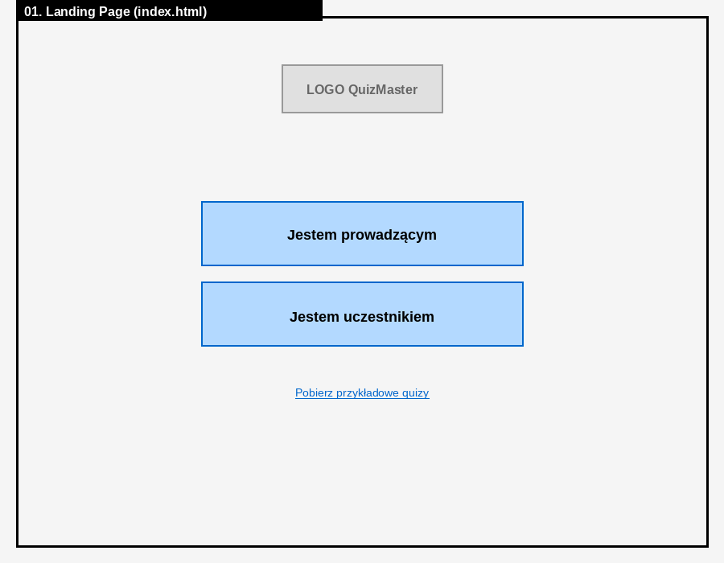
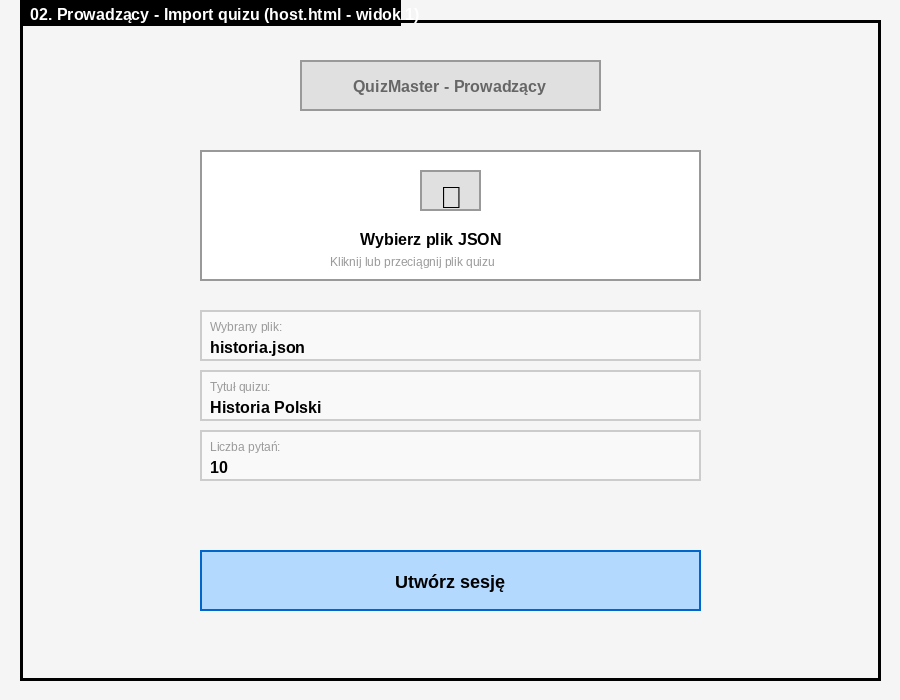
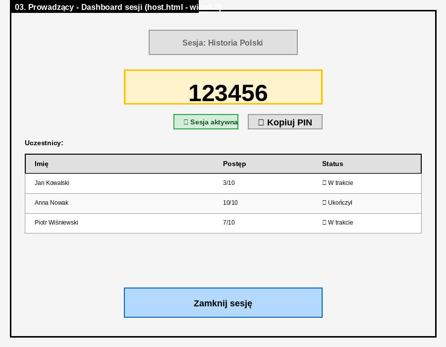
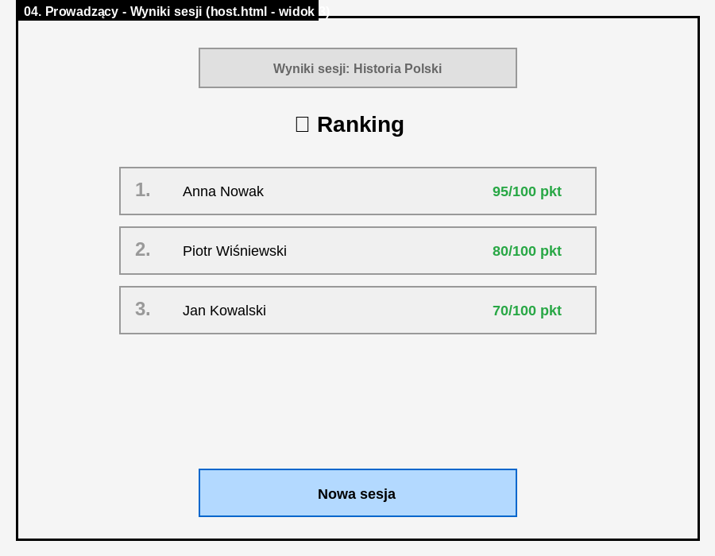
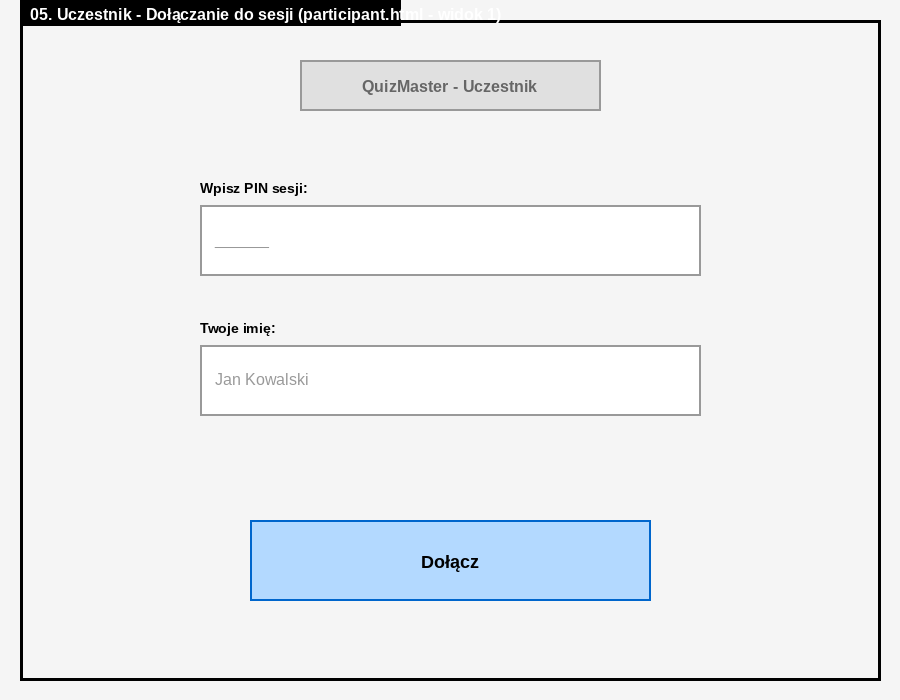
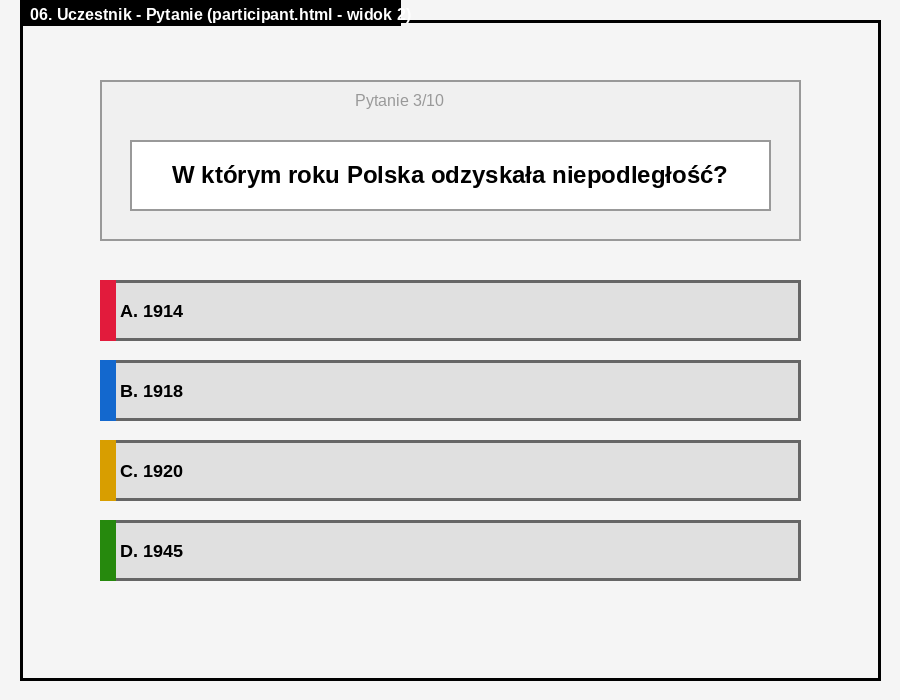
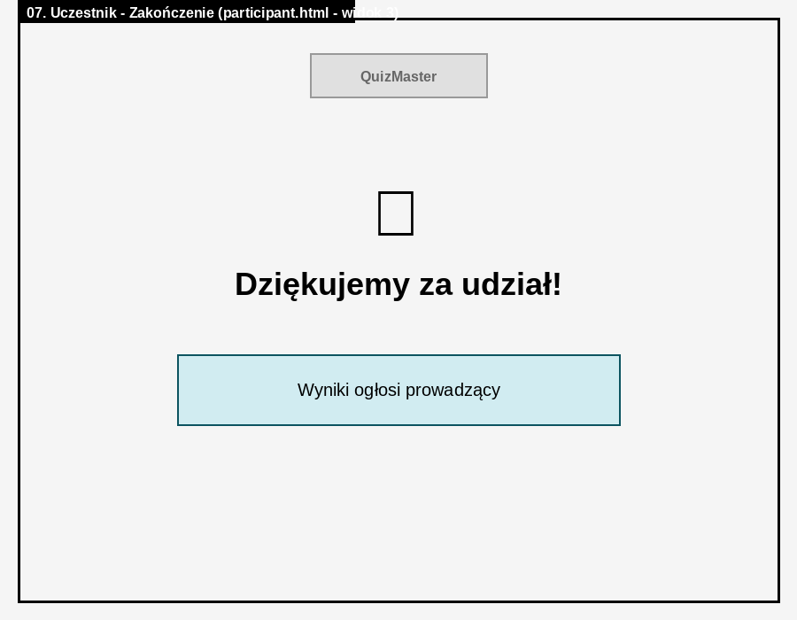

# Etap 1: Zarys projektu QuizMaster

## 1. Opis problemu

Nauczyciele, trenerzy i prowadzący zajęcia grupowe często potrzebują szybko sprawdzić wiedzę uczestników lub przeprowadzić interaktywny quiz podczas zajęć. Tradycyjne metody (papierowe testy, podnoszenie rąk) są czasochłonne, trudne do zorganizowania i nie angażują wszystkich uczestników równocześnie. 

**Problemy użytkowników:**
- **Prowadzący**: Trudność w szybkim przygotowaniu quizu, brak możliwości śledzenia postępów uczestników na żywo, konieczność ręcznego liczenia wyników
- **Uczestnicy**: Brak natychmiastowego feedbacku, problemy z anonimowością (strach przed oceną przez innych), nierówny dostęp do odpowiadania (głośniejsi dominują)

Potrzebne jest rozwiązanie, które pozwoli prowadzącemu szybko uruchomić quiz, a uczestnikom łatwo dołączyć i odpowiadać na pytania bez konieczności instalowania dodatkowego oprogramowania czy zakładania kont.

## 2. Docelowi użytkownicy

### Prowadzący (główny użytkownik)
- **Kim jest**: Nauczyciel, trener, wykładowca, prowadzący warsztaty
- **Umiejętności techniczne**: Podstawowe (potrafi obsługiwać przeglądarkę, otwierać pliki)
- **Cele**: Szybko przeprowadzić quiz, zobaczyć kto skończył, sprawdzić wyniki grupy
- **Kontekst użycia**: Podczas zajęć (sala lekcyjna, szkolenie online), czas ograniczony (45-90 min)

### Uczestnik
- **Kim jest**: Uczeń (liceum, studia), osoba szkolona, uczestnik warsztatów
- **Umiejętności techniczne**: Podstawowe (potrafi wpisać adres w przeglądarce, kliknąć przycisk)
- **Cele**: Dołączyć do quizu bez komplikacji, odpowiedzieć na pytania, sprawdzić swój wynik
- **Kontekst użycia**: Używa własnego telefonu lub komputera w pracowni

## 3. Rozwiązanie

**QuizMaster** to aplikacja webowa inspirowana Kahoot, która umożliwia prowadzenie quizów w trybie asynchronicznym (każdy uczestnik w swoim tempie).

### Kluczowe funkcje:

**Dla prowadzącego:**
1. Import quizu z pliku JSON (przygotowanego wcześniej)
2. Generowanie 6-cyfrowego PIN-u dla sesji
3. Dashboard pokazujący postępy uczestników w czasie rzeczywistym (kto dołączył, ile pytań rozwiązał)
4. Zamknięcie sesji i wyświetlenie rankingu z wynikami

**Dla uczestnika:**
1. Dołączenie do sesji przez wpisanie PIN-u i imienia
2. Rozwiązywanie quizu (pytania jednokrotnego wyboru)
3. Potwierdzenie zakończenia ("Dziękujemy za udział")

### Unikalne cechy:
- **Brak konieczności rejestracji** - uczestnik podaje tylko imię
- **Tryb asynchroniczny** - uczestnicy nie muszą odpowiadać równocześnie, każdy pracuje we własnym tempie (w przeciwieństwie do Kahoot gdzie wszyscy widzą to samo pytanie)
- **Brak stresu czasowego** - brak odliczania czasu przy pytaniach
- **Prosty deployment** - jeden plik HTML do otwarcia w przeglądarce

## 4. Narzędzia

### Technologie:
- **Frontend**: HTML5, CSS3, vanilla JavaScript (ES6+)
- **Przechowywanie danych**: localStorage API (symulacja backendu)
- **Hosting**: Brak (aplikacja działa lokalnie, pliki HTML)

### Biblioteki zewnętrzne:
- Google Fonts (Montserrat, Open Sans) - czytelna typografia

### Środowisko rozwoju:
- Edytor kodu (VS Code / WebStorm)
- Przeglądarka: Chrome / Firefox (developer tools)
- System kontroli wersji: Git

### Dlaczego te narzędzia?
- **Vanilla JavaScript** - zespół zna technologię, nie wymaga buildu ani zależności
- **localStorage** - zgodne z wymaganiami projektu (symulacja, nie pełna aplikacja)
- **Brak frameworka** - mniejsza złożoność, łatwiejszy debugging, szybsze prototypowanie

## 5. Odniesienia do innych rozwiązań

### Kahoot (kahoot.com)
**Jak rozwiązuje problem:**
- Prowadzący tworzy quiz w edytorze online
- Uczestnicy dołączają przez PIN
- Pytania wyświetlane synchronicznie (wszyscy widzą to samo)
- Ranking na żywo po każdym pytaniu

**Wady:**
- Wymaga konta i połączenia z internetem
- Synchroniczny tryb - stresujący dla wolniejszych uczestników
- Ograniczenie darmowej wersji (liczba uczestników)
- Brak możliwości pracy offline

**Co zrobimy lepiej:**
- Tryb asynchroniczny (każdy w swoim tempie)
- Brak konieczności rejestracji
- Działa lokalnie (bez serwera)

### Quizizz (quizizz.com)
**Jak rozwiązuje problem:**
- Asynchroniczny tryb (jak nasz)
- Natychmiastowy feedback po każdej odpowiedzi

**Wady:**
- Wymaga konta i internetu
- Skomplikowany interfejs (dużo opcji)
- Reklamy w darmowej wersji

**Co zrobimy lepiej:**
- Prostsza obsługa (mniej opcji = mniej zamieszania)
- Brak reklam i wymagań logowania

### Mentimeter (mentimeter.com)
**Jak rozwiązuje problem:**
- Interaktywne prezentacje z ankietami
- Wyniki na żywo

**Wady:**
- Głównie do ankiet, nie quizów z punktacją
- Wymaga konta premium dla większości funkcji

**Co zrobimy lepiej:**
- Skupienie na quizach edukacyjnych (z punktacją)
- Wszystko za darmo (open source)

## 6. Wizualizacja interfejsu

Poniżej przedstawiamy wireframe'y pokazujące planowany układ elementów w każdym ekranie aplikacji. Obrazki znajdują się w katalogu `mockups/`.

### Ekran główny (Landing Page)

**Elementy:**
- Logo QuizMaster na górze
- Dwa duże przyciski wyboru roli (Prowadzący / Uczestnik)
- Link do pobrania przykładowych quizów

---

### Interfejs prowadzącego

#### Widok 1: Import quizu

**Elementy:**
- Obszar do wyboru pliku JSON (drag & drop lub kliknięcie)
- Wyświetlenie informacji o wybranym quizie (tytuł, liczba pytań)
- Przycisk "Utwórz sesję"

#### Widok 2: Dashboard sesji

**Elementy:**
- Duży wyświetlacz PIN-u (żółte tło, wyraźne cyfry)
- Przycisk kopiowania PIN-u do schowka
- Tabela uczestników z postępem (imię, nr pytania, status)
- Przycisk "Zamknij sesję"

#### Widok 3: Wyniki

**Elementy:**
- Tytuł "Ranking" z emoji trofeum
- Lista uczestników posortowana według punktów
- Wyświetlenie wyniku każdego uczestnika (punkty/100)
- Przycisk "Nowa sesja"

---

### Interfejs uczestnika

#### Widok 1: Dołączanie do sesji

**Elementy:**
- Pole tekstowe na 6-cyfrowy PIN
- Pole tekstowe na imię uczestnika
- Przycisk "Dołącz"

#### Widok 2: Pytanie quizu

**Elementy:**
- Licznik pytań (np. "Pytanie 3/10")
- Treść pytania w dużej ramce
- 4 przyciski odpowiedzi (A, B, C, D) w różnych kolorach (czerwony, niebieski, żółty, zielony)

#### Widok 3: Zakończenie

**Elementy:**
- Emoji checkmark
- Komunikat "Dziękujemy za udział!"
- Informacja "Wyniki ogłosi prowadzący"

---

### Uwagi projektowe:

- **Paleta kolorów**: Inspirowana Kahoot - żywe kolory (fiolet, pomarańcz, czerwony, niebieski, żółty, zielony)
- **Typografia**: Duże, czytelne czcionki (Montserrat dla nagłówków, Open Sans dla tekstu)
- **Layout**: Centrowany, max szerokość 800px, responsywny
- **Przejścia**: Animacje fade-in/out między pytaniami
- **Dostępność**: Wysokie kontrasty, duże obszary klikalne

**Członkowie zespołu:**
- Dawid Bukowski
- Jan Bajor
- Kacper Dawid
- Michał Kryń

**Podział obowiązków:**
- Etap 1-2 (dokumentacja): Wspólnie
- Etap 3-4 (szkice, prototyp papierowy)
- Etap 5 (prototyp komputerowy)
- Etap 6 (finalna implementacja)

---

**Kontakt:**
- Repozytorium: [https://github.com/DawidBukowski/Graphic_Interfaces_project/]
- Prowadzący zajęć: dr Wojciech Palacz
- Data oddania:
